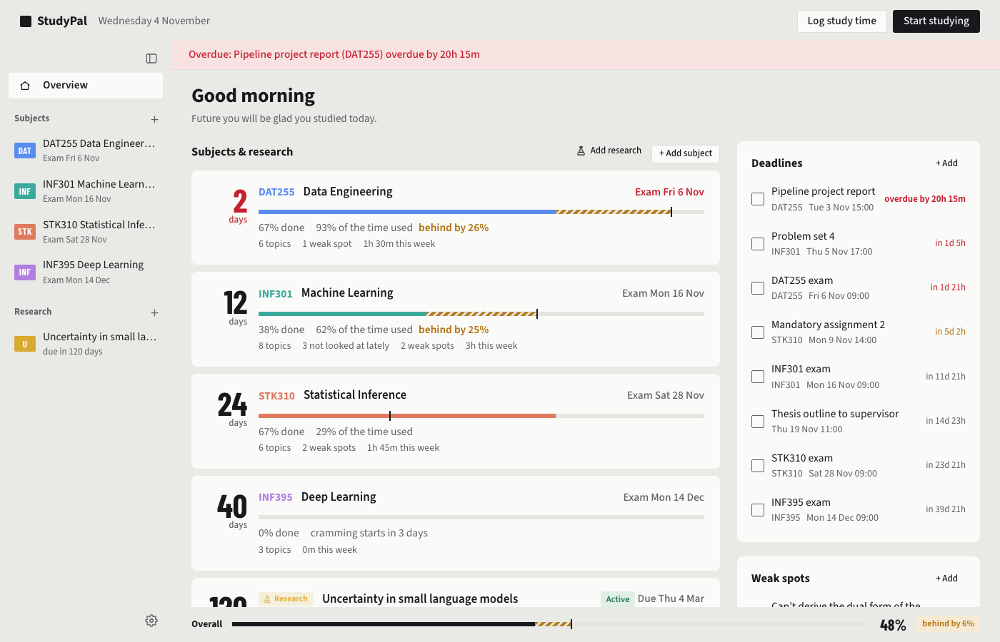

# StudyPal

A desktop study planner for Mac and Windows. It shows how far you are through each subject
compared with how much time is left before the exam, and helps you practise what you're weakest at.



## Features

- **Subjects with a cram timeline.** Each subject counts down to its exam and compares how much of
  the material is done with how much of the time has passed, so you see when you're falling behind.
- **Topics and weak spots.** Track each topic from "Not started" to "Confident", and note the
  things you keep getting wrong.
- **A study plant** on the overview that flowers when you're ahead of schedule and wilts the
  further behind you fall. It grows as you finish topics.
- **Badges** to collect by studying: hours studied, streaks of days in a row, early mornings,
  late nights, long sessions and more. Time you logged before badges existed counts too.
- **Daily to-do lists**, with the week ahead to plan in, unfinished to-dos carried forward when you
  want, and confetti for every one you tick off.
- **Statistics** on your study habits: totals, streaks, the last 12 weeks, a calendar of every day,
  and when in the day and week you study, and what on.
- **Deadlines** for assignments and exams, with notifications while the app is open.
- **Study time** with a timer, a Pomodoro, or a wheel you spin to decide how long to study, and a
  weekly chart of where your time went.
- **Reading lists** per subject, by book or by topic, with chapters you tick off.
- **Exams.** Add past exam papers (PDFs or photos) and StudyPal reads them into questions,
  matched with their solutions. You can then:
  - take an exam against the clock and have your answers graded;
  - see which topics went badly;
  - generate practice exams aimed at your weak topics.

  Reading, grading and generating use Gemini, Groq or a local Ollama model, chosen in Settings.
- **Research projects** for a thesis or paper, with notes, a journal, tasks, references (copied as
  APA) and shortcuts to Overleaf, Zotero, arXiv and the like.
- **Course banners**, made from the course or from a picture of your own.
- **Your look:** light, dark, a theme that follows the time of day, and a choice of font and text size.
- **Optional account** to keep your data online and use it on more than one computer. Without one,
  everything stays on your computer. The app works offline either way.

## Installation

Builds are made by GitHub Actions on every push to `main`. Open the latest successful
[Mac build](../../actions/workflows/mac.yml) or [Windows build](../../actions/workflows/windows.yml)
run, and download the zip from its **Artifacts** section. You need to be signed in to GitHub to
download it. Each zip is kept for 30 days.

### Mac (macOS 15 Sequoia or newer)

1. Download the build for your Mac's processor. To find out which you have, open
    → **About This Mac**. If it says **Chip: Apple M1** or newer, download
   `StudyPal-mac-apple-silicon`. If it says **Processor: Intel**, download `StudyPal-mac-intel`.
2. Unzip it and drag **StudyPal** into Applications.
3. The first time you open it, macOS warns that it can't check the app, because the app isn't
   signed by Apple. Close the warning, then go to **System Settings → Privacy & Security**, click
   **Open Anyway** next to the StudyPal message, and confirm.

### Windows (10 or 11)

1. Download `StudyPal-windows`, unzip it anywhere and double-click `StudyPal.exe`.
2. If SmartScreen warns about an unknown app, click **More info → Run anyway**.

### iPhone

The iPhone version is a web app with the same features as the desktop app. Open
[studypal.justesen.no](https://studypal.justesen.no/) in Safari, tap
**Share → Add to Home Screen**, and it opens like an app from then on. The first start downloads
Python (about 15 MB), so it takes a little while. After that it works offline too.

Your data is kept on the phone. To have the same subjects on the phone and the computer, sign in to the
same account on both. Two things work differently on the phone:
- **Exams:** add photos of the pages rather than PDFs. The phone can't read PDFs yet.
- **Notifications:** they only arrive while the app is open.

### Setting up the exam features

The exam features need a model. The easiest is a free Gemini key from
[Google AI Studio](https://aistudio.google.com/apikey), pasted in Settings (the gear icon). A free
key from the [Groq console](https://console.groq.com/keys) works too, or a local
[Ollama](https://ollama.com) model with no key. Keys stay on your computer.

## Building it yourself

You need Python 3.11+. On Mac:

```sh
uv venv --python 3.11 .venv
uv pip install -e ".[dev]"
.venv/bin/pytest
.venv/bin/studypal --demo        # the app with sample data
sh packaging/build-mac.sh        # makes dist/StudyPal-mac.zip
```

On Windows:

```bat
py -3.11 -m venv .venv
.venv\Scripts\pip install -e ".[dev]"
packaging\build-windows.bat
```

`python -m studypal.devserver --demo` runs the interface in a browser at http://localhost:8765.

The iPhone version runs the same Python in the browser with [Pyodide](https://pyodide.org). To build it
and try it:

```sh
.venv/bin/python mobile/build.py                 # makes dist/web
python3 -m http.server 8811 -d dist/web          # then open http://localhost:8811/?demo
```

`sh mobile/publish.sh` builds it and publishes it at https://studypal.justesen.no/ (GitHub Pages, from the
`studypal-web` repository).

## License

MIT
