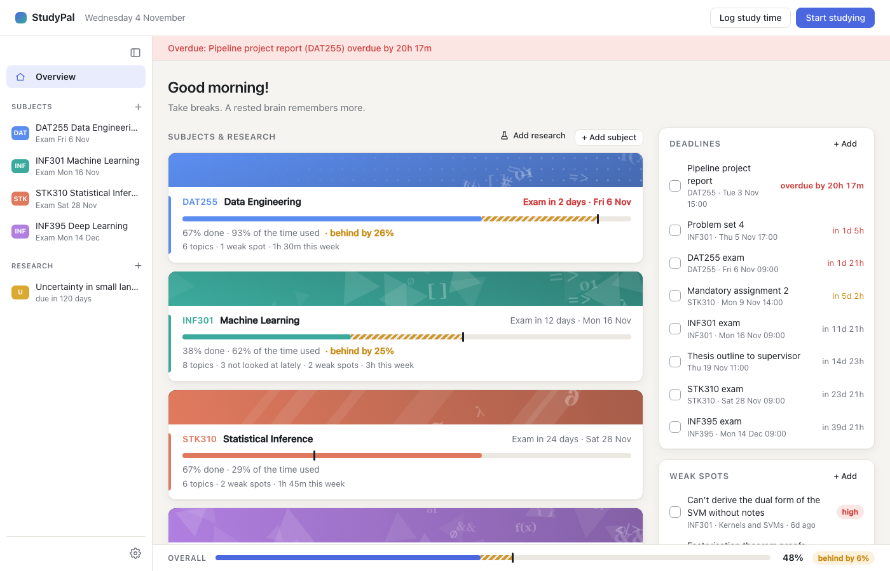
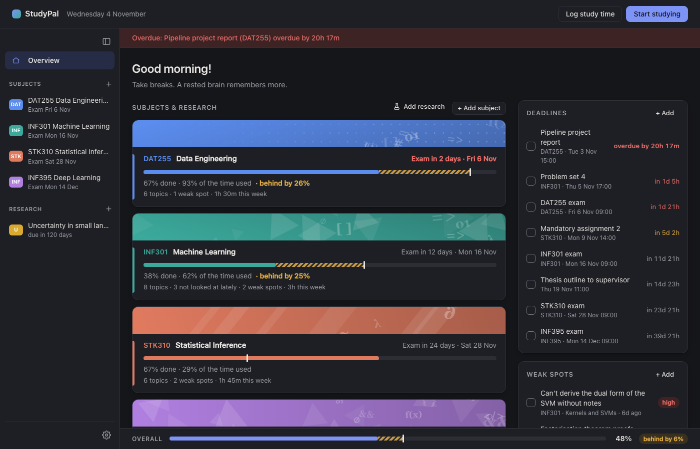
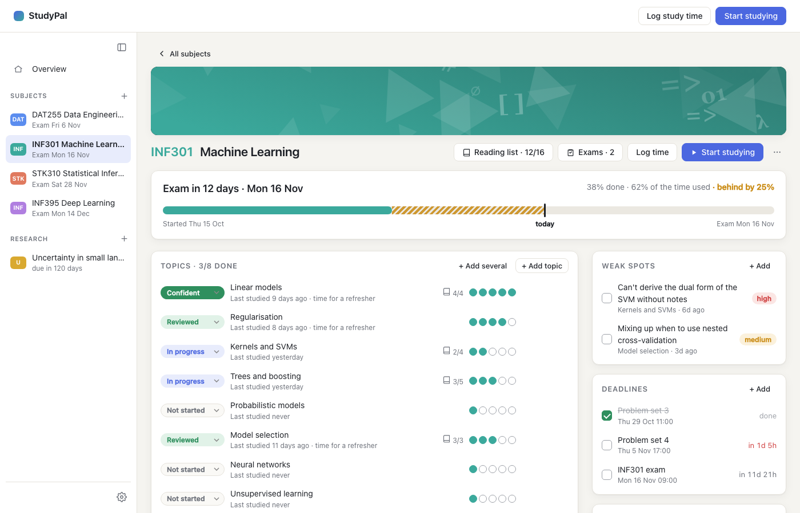
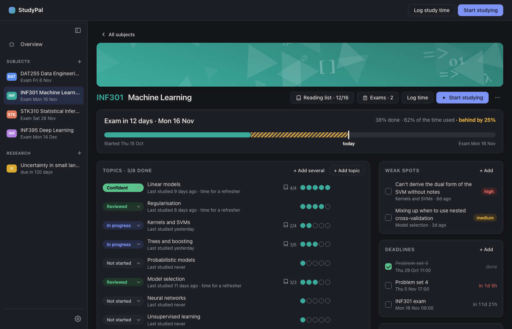
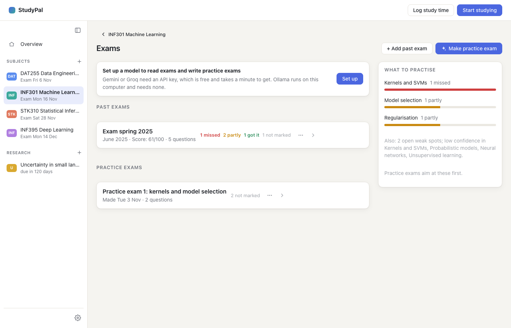
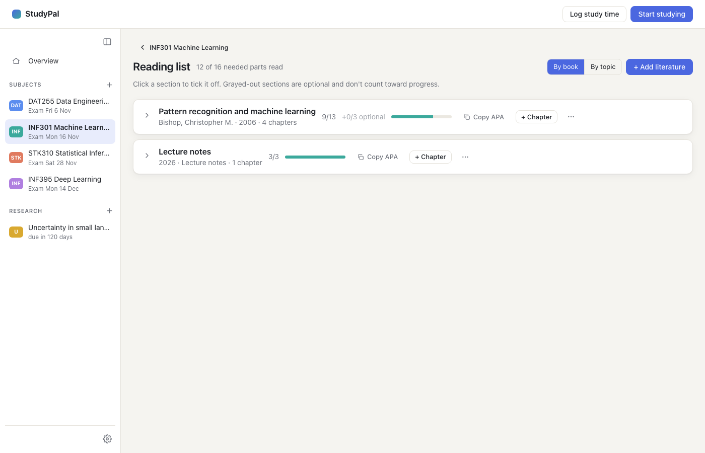

# Screenshots: previous design (`exam-attempts-and-banners`)

The built-in demo data (`--demo`), at 1400×900, light and dark mode. The branch `design-timetable` has the
same shots of the timetable design under the same names, for comparing side by side.

| | |
|---|---|
| Overview |   |
| A subject |   |
| Exams |  |
| Reading list |  |
